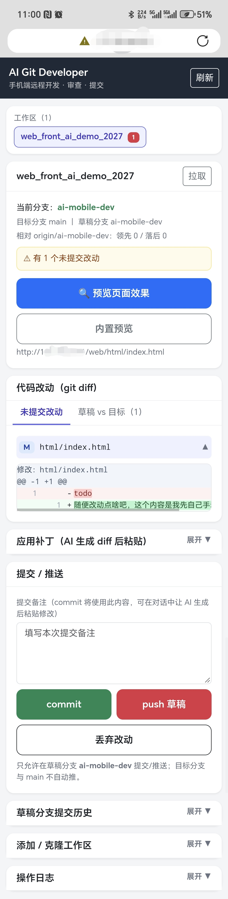
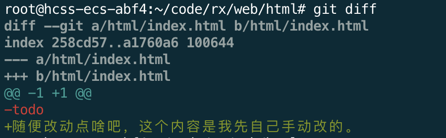

# 部署和运维（Deploy & Ops）

面向自托管部署：把 AI Git Developer 部署到一台公网 Linux 服务器，经 nginx 反向代理，用 systemd 常驻。设计背景与安全模型见 [DESIGN.md](DESIGN.md)。

## 前期准备

### 准备前端项目仓库

需要自己准备一台可以外网访问的 Linux 服务器，有没有域名都行，没有域名就直接通过 IP 访问。

然后在自己的 Git 仓库（Gitee / GitHub 都行）创建一个新的空白仓库，再去服务器上 `git clone <你的仓库地址>` 下来。如果不想做复杂配置，直接 clone 到服务器 nginx 的 root 配置目录下即可。

也可以直接使用正在开发中的一个前端项目。

这里，我直接用我自己新建的一个空白仓库举例，在我的服务器上的操作步骤如下：

```bash
## 创建好gitee空白仓库，复制地址，然后在服务器的nginx的root的目录下clone
## nginx的root的目录是 /root/code/rx 
## gitee空白仓库是 git@gitee.com:rxbook/web_front_ai_demo_2027.git
cd /root/code/rx 
git clone git@gitee.com:rxbook/web_front_ai_demo_2027.git
mv web_front_ai_demo_2027 web #改个短一点的名字
```

### 克隆当前项目

接下来，克隆本项目，建议克隆到nginx的root目录以外的目录，避免从浏览器访问到本项目的源代码或文档数据。

```bash
cd /root/code/tools
# Gitee
git clone https://gitee.com/rxbook/ai-git-developer.git
# 或 GitHub 镜像
# git clone https://github.com/renxingcode/ai-git-developer.git
cd ai-git-developer
cp config/config_demo.json config/config.json
# 可选：收紧权限，避免真实口令被同机其他用户读取
# chmod 600 config/config.json
vim config/config.json
```

接下来配置 `config/config.json`

## config.json 配置说明

### 配置项字段说明

全局字段：

| 字段 | 说明 |
|---|---|
| `listenAddr` | 监听地址，建议 `127.0.0.1:8767`（实际生效以此字段为准） |
| `port` | 兼容字段，程序启动只用 `listenAddr`，保留仅为旧配置兼容 |
| `password` | 访问口令（明文保存，文件权限 0600）；留空则不鉴权（仅限本机调试） |
| `basePath` | 子路径前缀，子路径部署设为 `/ai-git-developer` |
| `workspaces` | 工作区注册数组 |

workspace 元素字段：

| 字段 | 说明 |
|---|---|
| `name` | 显示名，同时作为唯一标识 |
| `path` | 工作区绝对路径（git 仓库根） |
| `repoUrl` | 克隆来源地址（注册已有目录时可空） |
| `targetBranch` | 目标分支：最终要合并进去的分支，如 `main` |
| `draftBranch` | 草稿分支：AI 在此开发，如 `ai-mobile-dev` |
| `previewFile` | 预览入口相对路径，如 `index.html` |
| `previewUrl` | 完整外部预览地址（可空，空则用工具内置预览） |

配置内容参考（程序支持在 JSON 中直接写 `//` 注释）：
```json
{
  "listenAddr": "127.0.0.1:8767",
  "port": 8767,
  "password": "pwd_2026_test",
  "basePath": "/ai-git-developer",
  "workspaceRoot": "",
  "workspaces": [
    {
      "name": "web_front_ai_demo_2027",
      "path": "/root/code/rx/web",
      "repoUrl": "git@gitee.com:rxbook/web_front_ai_demo_2027.git",
      "targetBranch": "main",
      "draftBranch": "ai-mobile-dev",
      "previewFile": "html/index.html",
      "previewUrl": "http://1.2.3.4/web/html/index.html" //这里的IP记得改成你自己的服务器的外网IP，有域名就改成域名
    }
  ]
}
```

> 注意：`listenAddr` 与下方 nginx 反代的目标端口必须一致（示例均为 8767）；`basePath` 与 nginx 的 location 前缀必须一致（示例均为 `/ai-git-developer`）。

### 让 AI 接手维护配置与接入指南（可选）

这里的 `config.json` 配置与接入指南的初始化可以完全交给 AI，不必手工编辑任何文件：

- **`config/config.json`**：可以自己复制 `config_demo.json` 修改；也可以不碰文件，直接把监听地址、访问口令、工作区路径、目标 / 草稿分支、预览入口等信息告诉 AI，由 AI 生成并补全 `config.json`。
- **`config/AI_AGENT_接入当前项目指南.md`**：让 AI 参照 `AI_AGENT_接入当前项目指南_demo.md` 的结构自行维护一份正式版，把服务器信息、项目信息、分支红线、常用命令等按对话持续写进去；之后每次开发只需让 AI 先读这份指南，即可按既定约定接管项目。

这两个正式文件均已被 `.gitignore` 忽略，真实的口令与服务器信息不会进入版本库；随仓库分发的只有 `*_demo` 示例。


## 编译和运行

在服务器上编译：

```bash
## 编译
cd /root/code/tools/ai-git-developer
go build -o ai-git-developer .

## 后台运行（nohup）
nohup ./ai-git-developer >> nohup.out 2>&1 &
## 查看日志
tail -f nohup.out
```

备注：
- 运行输出的日志会追加到 `nohup.out`；
- 操作日志按 `logs/年/月/日/ops.log` 分日存放。

### 可选：systemd 常驻（开机自启、崩溃自动拉起）

新建 `/etc/systemd/system/ai-git-developer.service`：

```ini
[Unit]
Description=AI Git Developer
After=network.target

[Service]
Type=simple
User=root
WorkingDirectory=/root/code/tools/ai-git-developer
ExecStart=/root/code/tools/ai-git-developer/ai-git-developer
# 值中含空格，必须整体加引号，否则 systemd 解析失败
Environment="GIT_SSH_COMMAND=ssh -i /root/.ssh/id_rsa -o StrictHostKeyChecking=no"
Restart=on-failure
RestartSec=3

[Install]
WantedBy=multi-user.target
```

启用：

```bash
systemctl daemon-reload
systemctl enable --now ai-git-developer
systemctl status ai-git-developer
journalctl -u ai-git-developer -f
```

> 推送走 SSH 时，确保运行用户（示例为 root）的 SSH 私钥已加到 Gitee / GitHub，且在服务器上手动执行过一次 `git push` 验证免密可用；若在 `~/.ssh/config` 中为主机配置了别名，确认别名配置无误。

## nginx配置 && 访问

### nginx配置
进入服务器的nginx的虚拟主机目录，例如：`/usr/local/nginx/conf/vhosts`

然后新建一个虚拟主机：`vim ai-git-developer.conf`

写入内容（有域名就把 `server_name` 换成域名；无域名保留 `_`，直接用 IP 访问）：
```nginx
server {
    listen       80;
    server_name  _;

    # AI Git Developer 控制台
    location ^~ /ai-git-developer/ {
        # 注意：末尾不带任何 URI（连斜杠也不要），原始路径会完整透传给程序，才能与 config.json 的 "basePath": "/ai-git-developer" 匹配
        proxy_pass http://127.0.0.1:8767;
        proxy_http_version 1.1;
        proxy_set_header Host              $host;
        proxy_set_header X-Real-IP         $remote_addr;
        proxy_set_header X-Forwarded-For   $proxy_add_x_forwarded_for;
        proxy_set_header X-Forwarded-Proto $scheme;
        proxy_connect_timeout 10s;
        proxy_read_timeout 120s;
    }

    # 无结尾斜杠时 301 补齐（页面相对路径资源依赖带斜杠的地址）
    location = /ai-git-developer {
        return 301 /ai-git-developer/;
    }
}
```

注意：
- 前缀必须用 `^~`：若站点存在静态文件正则规则（如 lnmp / 宝塔默认的 `location ~ .*\.(js|css)?$` 缓存），普通前缀 location 会被正则抢先命中，导致工具的 `assets/*.css|js` 被 nginx 当本地文件处理而 404；
- 若你不使用子路径部署，把 `config.json` 的 `basePath` 留空、location 改为 `/` 即可，两端规则必须成对修改。

### 访问
接下来，打开 `http://{YOUR_IP}/ai-git-developer/`（有域名则用域名），输入口令就可以访问了。
口令在 `config/config.json` 的 `password` 字段。

页面效果：



### 后续开发

接下来，打开你的 AI 智能体（比如：豆包、千问、Qoder 等），让 AI 阅读 `config/AI_AGENT_接入当前项目指南_demo.md`，把你的服务器信息告诉 AI，让 AI 将此文档复制一份为 `config/AI_AGENT_接入当前项目指南.md`，并写入你自己服务器和 Git 仓库的相关信息。

然后，把你想开发的功能告诉 AI；开发之后，打开 `http://{YOUR_IP}/ai-git-developer/` 查看代码变更，自行提交即可。

其实，即便不让 AI 改动，你自己手动改动的内容也会同样展示出来。所以它也适用于这样的场景：让另一个人在服务器上改完代码后，你通过手机浏览器在本工具里预览 git diff，本质完全一样。




### 设置 / 修改口令

- 编辑 `config/config.json` 的 `password` 字段，然后 `systemctl restart ai-git-developer` 生效；
- 若以 nohup 方式运行，可执行 `kill $(lsof -t -i:8767)` 结束进程后重新后台运行（端口以你实际的 `listenAddr` 为准）；
- 口令仅保存在服务器本地，不会上传到任何地方。

## 更新和升级

执行下面的命令：

```bash
cd /root/code/tools/ai-git-developer
git pull
go build -o ai-git-developer .
systemctl restart ai-git-developer
```

`config/` 与 `logs/` 均不随仓库更新，配置与工作区注册在升级后保留。
