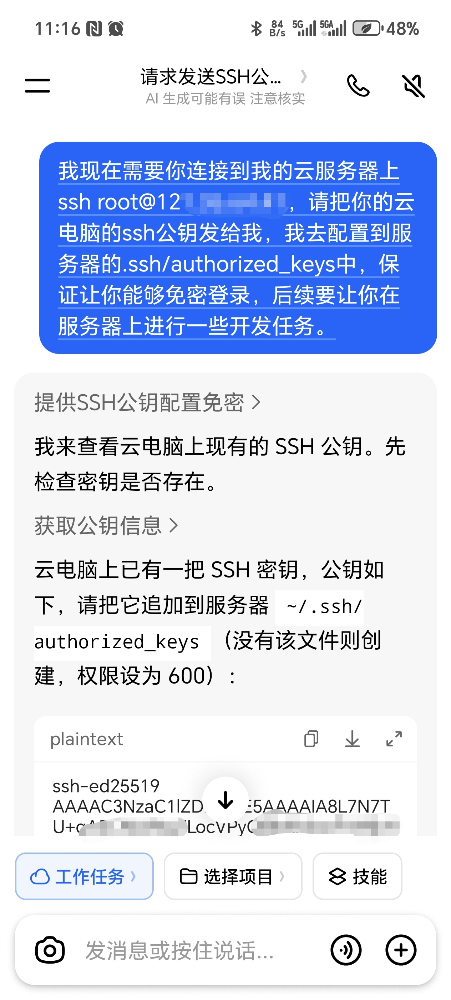

# 设计文档（Design）

> 一句话概述此工具：把IDE中的「工作区改动 → 可视化 git diff → 页面预览 → commit / push」整条链路搬到手机浏览器。**AI 负责写代码，你负责在手机上拍板**，全程不用开电脑。
>
> 关于「AI Git Developer 为什么存在、为什么这样设计」。功能概览见 [README](../README.md)，部署与配置见 [DEPLOY.md](DEPLOY.md)。
>
> 备注：本文内容起初是让AI生成的，然后我自己审核并补充了一些自己的想法。所以，阅读此文你会感受到AI语气和真人语气交织在一起的跳跃式感受。哈哈，应该也挺有意思的。

## 一、背景与定位

### 1.1 为什么做这个项目

> 首先问自己一个问题：有了AI辅助编程之后，人为什么还要钉在电脑前？

最近我在使用对话式AI（豆包）协作开发一个纯前端项目，传统协作模式依赖本地电脑：`AI 生成代码 → 本地 IDE 应用 → 本地预览 → 提交`。人一旦离开电脑（通勤、外出），开发就中断了。

然而我发现，和 AI 协作开发程序，最耗费时间的其实是纠错和提优化建议。于是我希望把这部分工作挪到不在电脑旁的碎片时间里：做一个手机端随时可访问的小工具——既能预览页面效果，又能在手机浏览器里查看 AI 生成的代码改动，类似 IDE 里的 git diff 效果。

这样一来，就可以利用碎片时间随时随地给 AI 提建议，让它修复和调整代码；提完建议切换APP去刷抖音，隔一会儿再回来检查成果，不用再干坐在电脑前盯着AI改代码、白白浪费时间。

甚至在户外跑步、爬山，或是和朋友打游戏的间隙，掏出手机给 AI 发一条指令，就能继续推进开发任务。真正做到了工作娱乐两不误，哈哈！

而且现在云服务器也能捡漏买到便宜的。我是去年年底买了一个华为云的“Flexus应用服务器L实例”，一年36块钱。我不是给华为云打广告，人家也不需要我这样的小卡拉米打广告。像这样的活动很多云服务器厂商都有，前两年我还在阿里云买过一个69一年的。虽然配置一般（2核、2G），但自己学习研究、跑点小项目完全够用。

服务器是 7×24 在线、Gitee 的代码仓库免费用、代码仓库也可以克隆在服务器上，缺的只是一个「手机端的工作区 / diff / 审查 / 提交」入口。于是我把这个入口做成了单二进制工具，让「手机对话 AI 改代码 → 手机审查 → 手机提交」的闭环成立。

### 1.2 竞品与差异化

「AI 写代码」赛道并不缺玩家，但现有方案要么把 AI 能力和代码绑在厂商云上，要么是通用 Web IDE 而非「AI 协作审查台」：

| 方案 | 形态 | 与本项目的差异 |
|---|---|---|
| GitHub Copilot coding agent、Cursor、Devin、MonkeyCode、Replit Agent | 云端 AI 开发 | AI 与代码都在厂商云上，数据不自主、模型不可替换 |
| OpenHands（开源 MIT） | 自托管 AI 开发环境 | 定位最接近，但很重（Docker + Python + React），部署与维护成本高 |
| code-server 等 | 通用 Web IDE | 是「编辑器」，不是面向手机小屏审查的「AI 协作审查台」 |

由此确立差异化定位：**Go 单二进制、零依赖、模型无关（对话 AI 与工具解耦）、手机优先、个人自托管的远程开发审查台**——不与大厂比「谁的 AI 更聪明」，只做「自己可控、手机可玩、部署极简」的小而美工具。而且，在这个实现和落地过程中也收获了很大的乐趣 —— 反正闲着也是闲着，做个工具出来玩玩也挺好的。

### 1.3 功能概述

**已实现的功能**

- 在手机浏览器中完成对服务器前端项目的：查看改动、代码级 diff 审查、页面预览、commit、push；
- 工具与具体项目解耦、与对话 AI 模型解耦，通用可复用；
- 单二进制、零外部依赖，便于自托管部署与开源发布。

**暂未实现的功能**

- 不在 Web 内置大模型对话（架构预留，见 [路线图](ROADMAP.md) v1.0）；
- 不处理后端 / 需构建（Node、打包器）的工程，首发面向**纯静态前端项目**（HTML/CSS/JS）；
- 不替代 IDE 的深度编辑能力——代码由对话 AI 产出，工具只负责审查与落盘。

## 二、核心概念

### 2.1 角色分工

- **AI 负责写代码**：产出改动（直接操作工作区，或只产出统一 diff 补丁）；
- **你负责拍板**：手机上审查行级 + 字符级 diff、预览页面，决定 commit / push / 丢弃。

### 2.2 草稿分支模型

每个工作区有两个关键分支：

- **目标分支（target）**：最终要合并进去的分支（如 `main`）；
- **草稿分支（draft）**：从目标分支自动创建并切换（默认 `ai-mobile-dev`），AI 的所有改动与提交只落在这里。

工具的全部写操作（应用补丁、commit、push）都限定在草稿分支；目标分支与 `main` 永远不被工具自动推送，最终合并由你在电脑上完成。手机端随时可 push 草稿分支做云备份，回家后坐在电脑前 `git fetch && git checkout <draft> && git pull`，IDE 复审后合并。

### 2.3 AI 如何到达服务器

一个容易被忽略的底层问题：**对话 AI 的「手」跑在哪？** 云端对话若绑定本地电脑（执行环境在本地），电脑一关「手」就没了；而服务器通常只认密钥登录，把 root 密码告诉 AI 这条路也走不通。

最简单的方式是 **SSH 直连**：让 AI 跑在一个不依赖你电脑的环境里（如手机 App 提供的云端执行环境），提前向AI的云环境索要 SSH 公钥，并把公钥追加到服务器的 `authorized_keys` 中。

## 三、功能说明

### 3.1 工作区管理

- 注册已有本地仓库：名称、路径、目标分支、草稿分支、预览入口；
- 路径不存在时，按仓库地址 `git clone`，再自动创建 / 切换草稿分支；
- 多工作区并存，顶部快速切换；移除工作区仅取消注册，不删磁盘文件。

### 3.2 状态展示

- 当前分支、目标分支、草稿分支；
- 相对 `origin/<draft>` 的领先 / 落后计数；
- 未提交改动（含未跟踪文件）、工作区是否干净；
- 草稿分支相对目标分支的文件差异；
- 草稿分支提交历史；
- 异常信息（路径不存在、非 git 仓库、分支缺失等）就地提示。

### 3.3 可视化 Diff

- 支持两个视图：**未提交改动**（工作区 vs index/HEAD）与 **草稿 vs 目标**（分支间）；
- 解析 git 统一 diff，按文件展示，识别新增 / 修改 / 删除 / 重命名 / 二进制；
- 未跟踪新文件通过 `git add -N`（intent-to-add）纳入 diff，整文件作为新增呈现；
- 行内字符级高亮：对配对的删 / 增行做 token 级最长公共子序列（LCS），只高亮真正变化的片段。英文 / 数字按连续词切分，中文按单字切分，空白与标点各自分块。

### 3.4 预览

- 内置静态文件服务：经工具安全读取工作区内文件并渲染，支持 HTML/CSS/JS 及其相对资源；
- 防目录穿越：规范化路径并解析符号链接，校验最终路径不超出工作区根；
- 也可配置外部预览 URL（如独立 nginx 静态站点）。

### 3.5 Git的常规操作

- **commit**：仅当处于草稿分支且有改动时允许，备注经临时文件 `-F` 传入（支持多行）；
- **push**：仅允许推送草稿分支，首次自动设置上游 `-u`；
- **apply patch（应用补丁）**：粘贴对话 AI 产出的统一 diff，先 `git apply --check` 校验、通过后应用到草稿分支工作区；不自动提交，应用结果进入「未提交改动」走正常审查流程；同样仅草稿分支可用。AI 由此无需任何服务器 SSH 权限；
- **discard**：`git reset` + `checkout -- .` 还原已跟踪改动，保留未跟踪新文件；
- **fetch**：更新远端引用。

### 3.6 安全模型

- 写操作（应用补丁、commit、push）**只作用于草稿分支**，从不对目标分支或 `main` 自动推送；补丁先经 `git apply --check` 校验且不自动提交；
- 丢弃改动（discard）只还原已跟踪文件，未跟踪的新文件保留；
- 可选访问口令，登录后写入 HttpOnly Cookie；空口令时不鉴权（仅建议本机调试）；
- 口令以明文保存在服务器本地 `config/config.json`（文件权限 0600），会话 Cookie 值为其加盐 SHA-256 摘要，不在传输与 Cookie 中暴露明文；
- 预览接口防目录穿越：规范化路径并解析符号链接，校验最终路径不超出工作区根；
- 所有写操作在服务端串行化（互斥锁），避免并发操作同一仓库；
- 公网部署务必设置访问口令，并置于 nginx（HTTPS）反向代理之后，监听地址保持 `127.0.0.1`；
- 工具不内置任何云端调用，所有数据保存在服务器本地 `config/` 与 `logs/` 目录。

### 3.7 数据与存储

运行时数据与可执行文件同目录存放，均已在 `.gitignore` 忽略；仓库只随附 `config/` 下的两个 `*_demo` 示例文件：

- `config/config.json`：全局配置与工作区注册（含口令明文，注意文件权限，见 [DEPLOY.md](DEPLOY.md) 部署说明）；
- `config/AI_AGENT_接入当前项目指南.md`：供对话 AI 读取的接入指南（服务器信息、分支红线、常用命令等，见同目录 `_demo` 示例）；
- `logs/年/月/日/ops.log`：操作审计日志（克隆、提交、推送、丢弃、应用补丁等），按日分文件，网页端读取最近 300 行（跨天自动回溯）。

字段级配置参考见 [DEPLOY.md](DEPLOY.md)。

## 四、关键设计决策

### 4.1 分支策略：自动草稿分支 + 可 push

- 从目标分支自动创建并切换到草稿分支（默认 `ai-mobile-dev`）；
- 手机端可随时 commit，并可 push 草稿分支做云备份；
- 目标分支与 `main` 永远不被工具自动推送，最终合并由作者在电脑上完成。

### 4.2 目前支持的范围：纯静态前端

- 面向无需构建的 HTML/CSS/JS 项目，预览即「直接打开 HTML」；
- 需 Node 构建、后端服务的工程留待后续。

### 4.3 技术选型：Go 单二进制

- 单二进制、内嵌静态资源、交叉编译方便，契合自托管；
- 通过 `os/exec` 调用系统 git，复用 git 全部语义，避免重复实现版本控制逻辑；
- 标准库即可完成主体、外部依赖少，维护成本低。

### 4.4 应用补丁收口

- 对话 AI 与服务器的连接方式不可控（云端对话绑定本地电脑时，电脑一关就无法操作了；服务器又只认密钥登录）；
- 因此工具提供「应用补丁」：AI 只产出统一 diff 文本，经网页粘贴、`git apply --check` 校验后落到草稿分支工作区；
- AI 从此不需要任何服务器 SSH 权限，所有落盘动作都被工具收口，也更安全（跑在云电脑还是手机端都无所谓）。

### 4.5 鉴权与会话：单用户口令模型

- 单用户口令（无多用户 / 角色，见路线图 v1.x），无数据库依赖；
- 会话 Cookie 有效期 7 天，HttpOnly + SameSite=Lax，Path 限定在 `<basePath>` 之下；
- 鉴权逻辑极简：空口令直通（本机调试），有口令则校验 Cookie 与口令摘要匹配。

### 4.6 设计原则（贯穿后续版本）

1. **模型无关、数据自主**：不绑定特定 AI 厂商，所有数据留在自己服务器；
2. **安全默认**：写操作需显式授权，正式分支永不被自动推送；
3. **手机优先**：关键审查与决策动作在小屏可独立完成；
4. **单二进制易部署**：能力增强不以牺牲部署简洁性为代价。

## 免责声明

本工具是个人开源的小项目，不内置任何 AI 模型，也不绑定、不代理任何 AI 服务，所有代码改动均由你所使用的对话 AI 或你本人发起；工具只提供工作区状态查看、可视化 diff、页面预览，以及受限的补丁应用与 git 提交能力。

请自行评估所用 AI 工具的安全性与可信度，谨慎授予其访问服务器的权限。

凡因阅读本文、使用本工具或依照本工具引导操作，导致所使用的 AI 或其他第三方窃取、篡改、损坏服务器数据，或造成任何直接、间接损失，作者概不承担任何责任。

**如果你无法接受这些风险，请不要使用本工具。**

-----

> 如果你喜欢这个小工具，欢迎到仓库 **Fork 并点个 Star**，这是对个人作者最大的鼓励；使用中遇到 Bug，或有任何建议、意见，欢迎提交 Issue 或 Pull Request，也可以到我的博客 [https://blog.csdn.net/rxbook](https://blog.csdn.net/rxbook) 留言交流。
>
- Gitee 仓库：[https://gitee.com/rxbook/ai-git-developer](https://gitee.com/rxbook/ai-git-developer)
- GitHub 仓库：[https://github.com/renxingcode/ai-git-developer](https://github.com/renxingcode/ai-git-developer)
- 本文在线阅读地址：[https://blog.csdn.net/rxbook/article/details/168558197](https://blog.csdn.net/rxbook/article/details/168558197)
